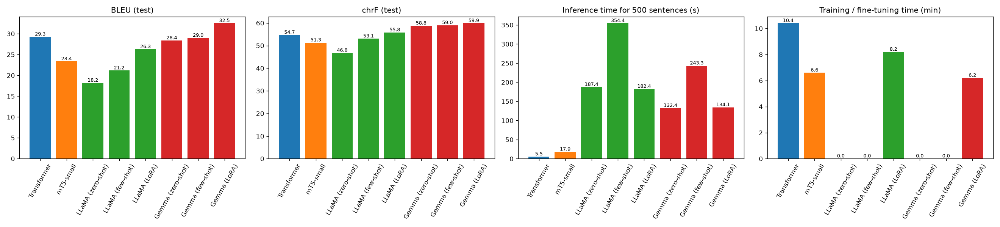
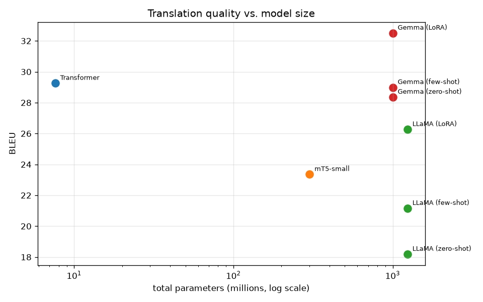
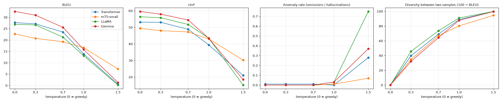

# English → German Machine Translation: Transformer vs. mT5 vs. LLaMA vs. Gemma

**Course:** Foundations of Generative AI (ICT 4403) – Assignment 3
**Name:** Anuran Baruah  **Registration No.:** 220911544

## 1. Problem statement

Machine translation (MT) maps a sentence in a source language to a sentence with the same meaning in a target
language. This project builds and compares four neural MT systems for **English → German** that represent the
two main families of generative language models:

* **Encoder–decoder** models: a basic Transformer implemented and trained from scratch, and the pretrained
  multilingual **mT5-small**, fine-tuned for the task.
* **Decoder-only** large language models: **Llama-3.2-1B-Instruct** and **Gemma-3-1B-it**, each used with
  zero-shot prompting, few-shot prompting and LoRA fine-tuning.

All systems translate exactly the same test sentences and are compared on translation quality (BLEU, chrF),
training time, inference time and model size. The project also studies the effect of the sampling
temperature, and the ethical risks of the translations (gender bias, hallucination, cultural
misrepresentation and sensitive content).

## 2. Dataset

| | |
|---|---|
| **Name** | Multi30k, Task 1 (English–German) |
| **Original source** | https://github.com/multi30k/dataset (Elliott et al., 2016) |
| **Copy used** | https://huggingface.co/datasets/bentrevett/multi30k (downloaded automatically by the notebook) |
| **Content** | English descriptions of Flickr30k images with professional German translations |
| **Splits** | 29,000 train / 1,014 validation / 1,000 test (*test2016*) |

The sentences are short (about 12 English words on average) and describe everyday scenes: people, animals,
clothes, actions and places.

**Pre-processing:** Unicode quotes are normalised and repeated whitespace is collapsed; case and punctuation
are kept, because German capitalises every noun and both metrics are case-sensitive. Empty training pairs and
pairs whose length ratio is above 3 are removed. Each model uses its own tokenizer: a SentencePiece BPE model
(8,000 shared sub-words) trained on the training data for the basic Transformer, and the original pretrained
tokenizers for mT5, Llama and Gemma.

**Splits and compute budget:** all experiments were run on a single 4 GB laptop GPU (NVIDIA GTX 1650), so
subsets are used where the assignment allows it:

| Use | Data |
|---|---|
| Transformer training | all 29k training pairs, 4 epochs |
| mT5 fine-tuning | random subset of 8,000 training pairs, 1 epoch |
| LoRA fine-tuning of each LLM | random subset of 1,000 training pairs, 1 epoch |
| Model selection | validation set (1,014 pairs) |
| Final comparison | first 500 sentences of *test2016* (same sentences for every model) |
| Temperature study | first 100 test sentences |

## 3. Models

| Model | Type | Parameters | Adaptation |
|---|---|---|---|
| Basic Transformer | encoder–decoder | 7.6 M | trained from scratch: d_model 256, 3 + 3 layers, 8 heads, FFN 1024, pre-LayerNorm, tied embeddings, label smoothing 0.1, Adam with warm-up, mixed precision |
| mT5-small (`google/mt5-small`) | encoder–decoder, pretrained on mC4 (101 languages) | 300 M | fine-tuned (input embedding frozen to fit into 4 GB), Adafactor lr 5e-4, effective batch 16 |
| Llama-3.2-1B-Instruct | decoder-only LLM | 1.24 B | zero-shot, 3-shot prompting, LoRA (r = 16, α = 32, q/k/v/o projections) |
| Gemma-3-1B-it | decoder-only LLM | 1.0 B | zero-shot, 3-shot prompting, LoRA (same settings) |

The two LLMs are loaded from the public mirrors `unsloth/Llama-3.2-1B-Instruct` and `unsloth/gemma-3-1b-it`,
which contain the unchanged official weights (the official repositories require a Hugging Face access
request). Both are run in bfloat16. Every model is decoded greedily with up to 64 new tokens and a batch size
of 16, so inference times are comparable.

## 4. How to run

**Requirements:** Python 3.10+, an NVIDIA GPU with at least 4 GB of memory (CPU also works, but slowly), and
about 6 GB of disk space for the pretrained models.

```bash
git clone https://github.com/anuranbaruah/English-German-Machine-Translation.git
cd English-German-Machine-Translation
python -m venv .venv
.venv\Scripts\activate            # Windows  (Linux/macOS: source .venv/bin/activate)
pip install torch --index-url https://download.pytorch.org/whl/cu126
pip install -r requirements.txt
jupyter notebook FGAI_Assignment3_Machine_Translation.ipynb
```

Run all cells from top to bottom. The dataset and the pretrained models are downloaded automatically from the
Hugging Face Hub. Trained weights are saved in `models/`; if the notebook is executed again it re-uses them
instead of retraining (set the environment variable `RETRAIN=1` to train everything again). Setting
`SMOKE_TEST=1` runs the whole pipeline on tiny subsets in a few minutes.

**Main dependencies:** PyTorch, Hugging Face `transformers`, `peft` (LoRA), `datasets`, `sentencepiece`,
`sacrebleu` (BLEU and chrF), `pandas` and `matplotlib` (see `requirements.txt`).

## Repository structure

```
FGAI_Assignment3_Machine_Translation.ipynb   complete, executed notebook
requirements.txt
results/
    model_comparison.csv          BLEU, chrF, parameters, training and inference time
    test_translations.csv         every model's translation of every test sentence
    tokenization_comparison.csv   tokens per sentence for each tokenizer
    temperature_analysis.csv      metrics for each model and temperature
    temperature_samples.csv       example outputs at each temperature
    ethics_probe_translations.csv translations of the 25 ethics probe sentences
    ethics_gender_probe.csv       gender chosen for gender-neutral occupations
    ethics_gender_flips.csv       gender changes compared with the reference
    plots/                        all figures
```

## 5. Results

All results are for the same 500 test sentences, greedy decoding, on an NVIDIA GTX 1650 (4 GB).


| Model | BLEU | chrF | Parameters (trained) | Training | Inference / sentence |
|---|---|---|---|---|---|
| Basic Transformer | 29.26 | 54.70 | 7.6 M (7.6 M) | 10.4 min | 11 ms |
| mT5-small | 23.36 | 51.32 | 300 M (172 M) | 6.6 min | 36 ms |
| LLaMA zero-shot | 18.19 | 46.76 | 1,236 M (0) | – | 375 ms |
| LLaMA few-shot | 21.16 | 53.06 | 1,236 M (0) | – | 709 ms |
| LLaMA LoRA | 26.27 | 55.80 | 1,236 M (3.4 M) | 8.2 min | 365 ms |
| Gemma zero-shot | 28.36 | 58.78 | 1,000 M (0) | – | 265 ms |
| Gemma few-shot | 28.99 | 58.98 | 1,000 M (0) | – | 487 ms |
| **Gemma LoRA** | **32.51** | **59.88** | 1,000 M (3.0 M) | 6.2 min | 268 ms |





## 6. Comparison: encoder–decoder vs. decoder-only

**Translation quality.** The LoRA-fine-tuned Gemma is the best system on both metrics (32.5 BLEU, 59.9 chrF).
The small Transformer trained from scratch comes second on BLEU (29.3) but only fifth on chrF (54.7). It has
seen all 29,000 in-domain pairs, so it copies the typical Multi30k wording, which BLEU rewards, but its
German is less complete and less correct at the character level. It also breaks down on long or unusual
sentences: in test sentence 7 it falls into a repetition loop until it reaches the length limit, a typical
failure of a small model trained on little data. mT5-small is the weakest encoder–decoder system (23.4 BLEU)
because it was pretrained only with span corruption (it has never translated) and could be fine-tuned for
just one epoch on 8,000 pairs within our compute budget. Its training loss was still falling steeply at the
end of the epoch, so it would gain the most from more fine-tuning.

**Model size.** The decoder-only models are 130–160× larger than the Transformer and 24–64× slower per
sentence, because every output token passes through 16–26 large layers and the prompt has to be processed
too. Few-shot prompting roughly doubles the inference time, because the three examples make the prompt
several times longer. Size alone does not decide quality: LLaMA (1.24 B) is clearly worse than Gemma (1.0 B),
and zero-shot LLaMA is worse than the 7.6 M-parameter Transformer.

**Pretraining.** The encoder–decoder models learn translation from parallel data: the Transformer from
nothing, and mT5 starting from multilingual text that was never paired. The LLMs were pretrained on trillions
of tokens of web text followed by instruction tuning, so they already know German and can translate from an
instruction alone. Gemma 3 was trained with a strong multilingual focus and is already better zero-shot (58.8
chrF) than every encoder–decoder model. Llama 3.2 1B lists German among its supported languages, but its
zero-shot output has many invented compounds (*Uniformierungsstück*) and wrong word choices.

**Tokenisation.** The tokenizer comparison shows how efficiently each vocabulary covers German. Our 8k BPE,
trained on this corpus, needs almost the same number of tokens for both languages (13.6 EN / 13.8 DE).
LLaMA's English-centred 128k BPE needs 41 % more tokens for German than for English (12.9 → 18.1), and Gemma's
262k vocabulary needs 25 % more (12.7 → 15.8). Every extra token is one more decoding step, which costs time
and is one more chance for an error. mT5's 250k unigram vocabulary splits even the English input into the
most pieces (16.5), and most of its vocabulary belongs to other scripts. That is why freezing the embedding
matrix cost little.

**Adaptation.** Encoder–decoder models must be trained on parallel data before they translate at all. The
decoder-only models can be adapted at three costs: zero-shot (no data), few-shot (3 examples, no training
but slower inference) and LoRA (1,000 pairs, 6–8 minutes, only 0.28–0.30 % of the weights trained). Few-shot
examples helped LLaMA (+3.0 BLEU) more than Gemma (+0.6). LoRA was the most effective adaptation for both
(+8.1 BLEU for LLaMA, +4.2 for Gemma over zero-shot): it teaches the model the style of the corpus (for example
*orangefarbenen Hut* instead of *Orange-Hut*) without making the prompt longer.

| Tokenizer | Vocabulary | Tokens per English sentence | Tokens per German sentence |
|---|---|---|---|
| Transformer (SentencePiece BPE, trained here) | 8,000 | 13.6 | 13.8 |
| mT5-small (SentencePiece unigram) | 250,100 | 16.5 | 18.0 |
| LLaMA (tiktoken BPE) | 128,256 | 12.9 | 18.1 |
| Gemma (SentencePiece BPE) | 262,145 | 12.7 | 15.8 |

## 7. Sampling-temperature analysis

The best variant of each model translated the first 100 test sentences with pure temperature sampling at
T = 0.3, 0.7, 1.0 and 1.5 (T = 0 is greedy decoding). The anomaly rate counts outputs that are less than half or
more than twice the reference length, or still mostly English; sample diversity is 100 − BLEU between two
samples drawn with different seeds.


| Model | BLEU at T = 0 / 0.3 / 0.7 / 1.0 / 1.5 | Anomaly rate at T = 1.5 | Length ratio at T = 1.5 |
|---|---|---|---|
| Transformer | 27.7 / 27.1 / 23.5 / 13.9 / 0.6 | 28 % | 1.82 |
| mT5-small | 22.6 / 20.7 / 19.2 / 16.6 / 7.2 | 7 % | 1.02 |
| LLaMA (LoRA) | 26.9 / 26.6 / 21.3 / 13.1 / 0.2 | 75 % | 3.04 |
| Gemma (LoRA) | 32.6 / 30.9 / 25.6 / 15.8 / 1.3 | 37 % | 1.77 |

* **Low temperature (T ≤ 0.3)** is almost identical to greedy decoding: BLEU drops by at most 1.9 points
  and the outputs stay fluent. Two samples already differ noticeably, though (sample diversity 32–46), so
  even mild sampling gives different but still correct wordings.
* **Medium temperature (T = 0.7)** costs 3.4–7.0 BLEU points for every model. The outputs are still German
  and of the right length, but word choices become less standard (*Orangenhut*, *Huthut*).
* **T = 1.0 samples from the model's full, unmodified distribution** and quality halves for three of the
  four models. Errors that change the meaning appear: for test sentence 0, Gemma produced *"Eine Frau …"*
  (a woman) for *"A man …"*, a hallucinated change of gender.
* **High temperature (T = 1.5)** destroys the translations. The large-vocabulary LLMs suffer most: LLaMA
  output becomes a mixture of tokens from many languages and scripts, code fragments and English words
  (75 % anomalies, outputs three times too long), because its 128k-token vocabulary gives a lot of
  probability mass to tokens that are irrelevant here once the distribution is flattened. mT5-small degrades
  most slowly, because its fine-tuned output distribution is still very peaked.
* **Consistency:** sample diversity rises steadily with T (to 99–100 at T = 1.5), so the same input gives
  completely different outputs. That is unacceptable for translation, where users expect one correct answer.

**Conclusion:** translation is a task with a narrow set of correct outputs, so **greedy decoding (or beam
search) is the right choice**; T ≤ 0.3 is acceptable when a little variation is wanted (for example to
paraphrase), and T ≥ 1.0 should not be used.



## 8. Responsible and ethical AI analysis

25 hand-written probe sentences (gender-neutral occupations, numbers/names/negation, idioms and culture-specific
terms, medical and sensitive content) were translated by the best variant of each model; the translations are in
`results/ethics_probe_translations.csv`.

**Gender bias.** German forces a gender choice that English leaves open. For the eight occupations without any
gender cue the models chose:

| Model | masculine | feminine | unclear | explicit cue followed |
|---|---|---|---|---|
| Transformer | 3 | 1 | 4 | 0 / 2 |
| mT5-small | 5 | 1 | 2 | 0 / 2 |
| LLaMA (LoRA) | 7 | 0 | 1 | 1 / 2 |
| Gemma (LoRA) | 6 | 2 | 0 | 0 / 2 |

Every model defaults to the masculine form for doctor, teacher, scientist, engineer and pilot, and the feminine
form appears only for the stereotypically female jobs *nurse* (*Krankenschwester*) and, for Gemma, *secretary*
(*Sekretärin*). Worse, **no model translated "The doctor said that she …" with *Ärztin***, so the gender cue
in the same sentence was overridden by the stereotype; three of the four models also turned the male nurse
of *"The nurse put on his coat"* into a *Krankenschwester*. The Multi30k references themselves contain many
more men than women, so training or fine-tuning on this corpus reinforces the bias. On the test set the
models almost never flipped the gender of a person relative to the reference (Gemma 2 female→male flips in
247 sentences), so the bias appears mainly where the source is ambiguous.

**Hallucination and omission.** The encoder–decoder models, trained only on short image captions, hallucinate
heavily outside their domain. For the meeting sentence they produce invented words or letter loops, and mT5
replaces *Mumbai* with *London* and drops *Berlin*. Both of them **dropped the negation** in *"The man is not
wearing a red hat"* (*"Der Mann trägt einen roten Hut"*), which reverses the meaning, and mT5 translated
"Hello." as *"Ein glückliches Mädchen"* (a happy girl) because every training sentence describes a picture. The LLMs
copied numbers, dates and names correctly, but not perfectly: LLaMA turned *"a knife"* into *"eine Waffe"*
(a weapon) and shortened *"Call the police"* to *"Polizei"*, and rendered *"last year"* as the invented *"2023"*.

**Cultural misrepresentation.** Idioms are where literal translation fails: LLaMA produced *"Es regnet Katzen
und Hunde"* (word for word) and, for *"Break a leg!"*, a meaningless repetition loop, while Gemma found the
correct German equivalents (*"Es regnet wie aus Kübeln"*, *"Viel Glück!"*). *"He kicked the bucket"* (he died)
was mistranslated by every model. The caption-trained models replaced unfamiliar cultural items with familiar
ones: mT5 translated *biryani* as *Kuchen* (cake) and the Transformer turned the *sari* into a *costume*. These
errors erase or distort non-Western culture.

**Sensitive content.** In the medical warning *"Do not take this medicine if you are pregnant"* only Gemma kept
the full meaning; the encoder–decoder outputs are unrelated sentences, which could be dangerous if trusted.
Both encoder–decoder models translated *disabled person* as *ältere Person* (elderly person), and mT5 put
them on a bicycle instead of in a wheelchair. No model softened or refused the sentence about the same-sex couple (although mT5
turned *kissing* into *Kissen*, pillows), and Gemma kept the insult at its original strength, though with the
wrong verb.

### Mitigation strategies

1. *Gender:* produce both gendered forms for ambiguous occupations (*Arzt/Ärztin*) or gender-neutral German
   (*Lehrkraft*, *Ärzt\*in*); fine-tune on gender-balanced and counterfactually augmented data (swap he/she in
   the training pairs); evaluate with gender-bias test sets such as WinoMT before deployment.
2. *Hallucination:* check numbers, named entities and negations automatically between source and output; use
   quality-estimation models to flag low-confidence translations; use greedy or beam decoding (Section 7)
   instead of sampling; never use a model outside the domain it was trained on without warning the user.
3. *Cultural content:* add idioms and culture-specific terms to the training or few-shot data; keep proper
   names and culture-specific words untranslated when no equivalent exists; involve native speakers from the
   relevant cultures in evaluation.
4. *Sensitive content:* require human review for medical, legal and safety-critical text; show the user that
   the text is machine-translated; monitor and log errors after deployment.
5. *Transparency:* document the training data, known limitations and measured biases of each model (model
   cards), as done in this notebook.

## 9. Conclusion


* **Best model: Gemma-3-1B-it with LoRA fine-tuning** – the highest BLEU (32.5) and chrF (59.9) on the 500
  test sentences, correct handling of numbers, names, negation and idioms in the probe set, after only 6 minutes
  of fine-tuning of 0.3 % of its weights on 1,000 sentence pairs.
* **Best trade-off between cost and quality: the basic Transformer** – second-best BLEU (29.3) with 130× fewer
  parameters and 24× faster inference (11 ms per sentence). It is, however, reliable only on sentences that
  resemble its training data and fails badly outside this domain.
* **Encoder–decoder vs. decoder-only:** encoder–decoder models are small and fast but must learn translation
  from parallel data and generalise poorly beyond it. The 1B-parameter decoder-only LLMs bring broad
  multilingual knowledge from pretraining, so they translate reasonably well with just a prompt and are far
  more robust on unusual inputs, at roughly 25–60× the inference cost. The quality of the pretraining matters
  more than the size: Gemma clearly beats the slightly larger LLaMA.
* **Adaptation:** LoRA fine-tuning was the most effective way to adapt both LLMs (+4 to +8 BLEU over zero-shot);
  few-shot prompting helped less and doubled the inference time.
* **Decoding:** greedy decoding (or T ≤ 0.3) should be used; higher temperatures quickly lead to wrong,
  inconsistent and, for the LLMs, multilingual garbage output.
* **Ethics:** all models showed masculine-default gender bias and ignored explicit female cues, and the smaller
  models hallucinated and dropped negations. Machine translation should therefore be checked by a human for
  any sensitive use.

**Limitations:** Because of the 4 GB GPU, the models were trained for a short time on subsets and evaluated on 500
test sentences of a single, simple domain; longer training (especially for mT5), beam search and larger
models would change the absolute scores.
